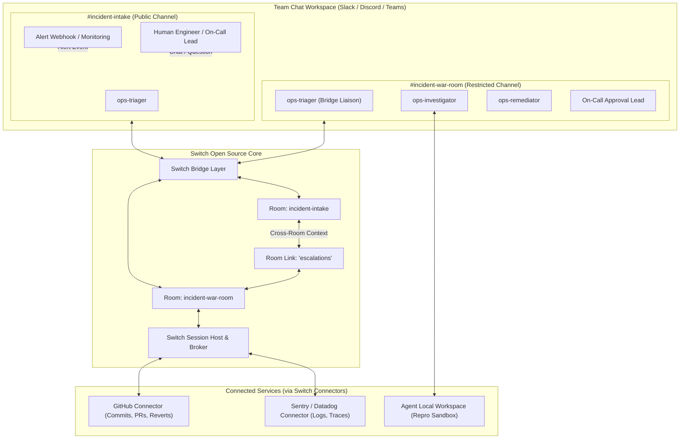
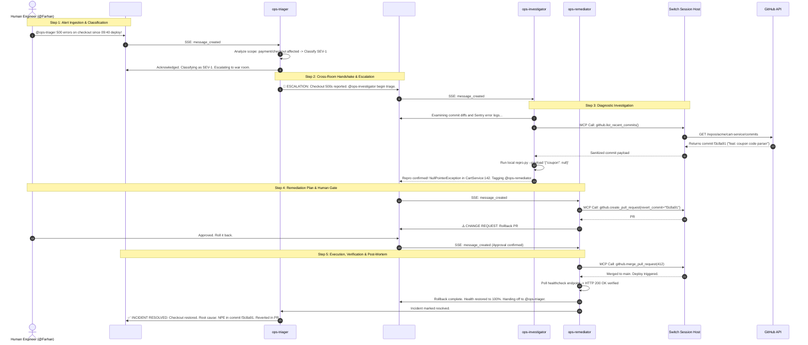
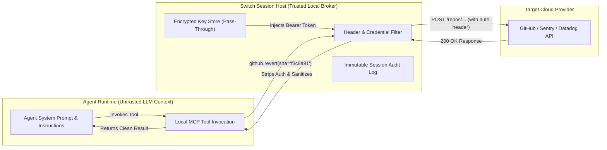

# OpsSwitch: Autonomous Incident Commander & War Room

> **Flip the Switch Hackathon — Flagship Entry for Track 01: Best Business Workflow ($2,000)**  
> **Team:** Algo Alchemist (`K8H5DE`) | **Author:** Farhan Mallik (`@farhanmallik` / `farhanmallik05`)

[](https://switchagents.ai)
[](LICENSE)
[](https://wisprflow.ai)
[](https://github.com/sandbox-quantum/switch)
[](tests/test_incident_flow.py)

---

## 🚀 Overview

**OpsSwitch** transforms enterprise incident management from frantic context-switching across browser tabs into a calm, automated, human-supervised collaboration inside team chat.

Using **Switch**, OpsSwitch deploys a squad of autonomous AI teammates across two linked channels (`#incident-intake` and `#incident-war-room`). When an anomaly or crash occurs:
1. **`ops-triager`** intercepts the alert in `#incident-intake`, filters out false positives, classifies severity (SEV-1 to SEV-4), and initiates an escalation thread.
2. **`ops-investigator`** receives the handoff in `#incident-war-room`, inspects recent git commits and error traces, writes a minimal reproduction test, and isolates the offending line of code.
3. **`ops-remediator`** drafts an emergency rollback or hotfix PR, computes risk metrics, and presents an interactive authorization prompt to the human On-Call Engineer.
4. **Human Engineer** signs off with a single message (`"Approved. Roll it back."`).
5. **`ops-remediator`** triggers the GitHub rollback, monitors health recovery, and writes an automated RCA (Root Cause Analysis) post-mortem back to `#incident-intake`.

```
        ┌─────────────────────────────────────────────────────────┐
        │                 SLACK / DISCORD CHAT                    │
        │                                                         │
        │  [#incident-intake]               [#incident-war-room]  │
        │   • Alert arrives                  • Log triage         │
        │   • Customer reports               • Commit diff audit  │
        │   • Executive updates              • Repro execution    │
        │            │                               │            │
        │      ops-triager ───────────────►  ops-investigator    │
        │     (Triage & Dedup)   (Linked Room)       │            │
        │                                            ▼            │
        │                                      ops-remediator     │
        │                                     (Patch & Rollback)  │
        │                                            │            │
        │   Human On-Call Lead ◄─────────────────────┘            │
        │   "Approved. Roll it back."                             │
        └─────────────────────────────────────────────────────────┘
```

---

## 💡 Why Switch is Central (Judging Rubric #1)

OpsSwitch **cannot function as a generic single-agent chatbot**:
- **Room Topology**: It requires cross-room context isolation. Customer-facing engineers and stakeholders in `#incident-intake` should not be flooded with hundreds of lines of stack traces, git diffs, and repro output generated in `#incident-war-room`. Switch's **linked rooms** provide clean, selective context transmission (`label: escalations`).
- **Agent-to-Agent Delegation**: The Triager invokes the Investigator by name (`@{team}-investigator`), and the Investigator passes reproduction evidence directly to the Remediator (`@{team}-remediator`).
- **True Multi-Harness Teammates**: The Triager can run on Claude Code locally, the Investigator on Codex CLI, and the Remediator on an isolated enterprise server—unified seamlessly by the **Switch Agent Protocol** (SSE streaming in, HTTP posting out).
- **Zero Token Leakage**: Third-party credentials (GitHub tokens, Sentry keys) are brokered through Switch's secure session host, never injected into the LLM context.
- **Strict Human-in-the-Loop Sign-off**: Remediator cannot execute merges or rollbacks without verbatim authorized human approval.

---

## 📐 Architecture & Interaction Flows

### 1. Dual-Room System Topology



### 2. End-to-End Sequence Diagram



### 3. Zero-Leakage Credential Security Architecture



---

## 🛠️ Quickstart (Run in Under 60 Seconds)

### 1. Requirements
- Python 3.11+
- Dependencies: `pip install -r requirements.txt` (or use `uv`)

### 2. Run the Incident Simulation CLI

```bash
# Automated end-to-end incident lifecycle simulation (CI mode)
python scripts/simulate_incident.py --auto-approve

# Or using the justfile:
just simulate

# Run in interactive mode (prompting you for the human sign-off gate)
python scripts/simulate_incident.py --mode interactive

# Run as background mock microservice server
python scripts/simulate_incident.py --mode serve --port 8000
```

### 3. Run the Test Suite

```bash
# Run all 7 testing pillars with verbose reporting
pytest tests/test_incident_flow.py -v

# Or using the justfile:
just test
```

### 4. Deploying via Switch Console

1. Launch **Switch Console Desktop**.
2. Go to **Templates** → **Import Custom Template**.
3. Select `template.yaml` (or `templates/opsswitch/template.yaml`).
4. Configure parameters:
   - `team`: `sre`
   - `provider`: `claude` / `codex` / `opencode`
   - `bridge`: `slack` / `discord` / `teams`
5. Click **Launch Group**. Switch creates `#sre-incident-intake` and `#sre-incident-war-room`, spawns the 3 agents, and wires the cross-room escalation link.

---

## 📁 Repository Structure

```
├── template.yaml                       # Root Switch v1 Template specification
├── templates/
│   └── opsswitch/
│       └── template.yaml               # Packaged template for Switch Console
├── scripts/
│   └── simulate_incident.py            # CLI incident simulator with mock FastAPI service
├── tests/
│   └── test_incident_flow.py           # 7-pillar Pytest integration suite
├── pyproject.toml                      # Project metadata & Pytest configuration
├── requirements.txt                    # Python dependencies
├── justfile                            # Runner recipes (simulate, test, serve)
├── plan/                               # Master hackathon blueprints & specifications
│   ├── 01_FLAGSHIP_PROJECT_BLUEPRINT/  # Specs, diagrams, demo scripts
│   ├── 02_CORE_CONTRIBUTIONS_TRACK_03/ # Supabase & Sentry connector specs
│   ├── 03_BLOG_TRACK_AIRPODS_5/        # DEV.to technical article
│   ├── 04_WISPR_FLOW_VOICE_TRACK/      # Wispr Flow dictation scripts
│   ├── 05_SOCIAL_MEDIA_KEYBOARD_TRACK/ # Social posts & teaser script
│   └── 06_EXECUTION_TIMELINE_AND_CHECKLISTS/ # Pre-flight checklist
└── switch-repo/                        # Upstream Switch repository with Track 03 contributions
    └── core/switch_core/connections/catalog/
        ├── supabase/                   # Issue #827: Supabase connector & skill
        └── sentry/                     # Issue #820: Sentry connector & skill
```

---

## 🏆 Hackathon Tracks & Team Details

- **Hackathon:** [Flip the Switch Hackathon](https://switchagents.ai) (WeMakeDevs × DevTools Academy × Switch)
- **Team Name:** Algo Alchemist
- **Team Code:** `K8H5DE`
- **Team Lead:** Farhan Mallik ([@farhanmallik05](https://github.com/farhanmallik05))
- **Track 01 (Flagship):** OpsSwitch Autonomous Incident Commander & War Room
- **Track 03 (Core Contributions):** 5 Upstream PRs (#1397, #1399, #1467, #1471, #1490) across Contributor Quickstart, Agent Controller Guide, Supabase, Sentry, and Stripe Connectors
- **Side Tracks:** Wispr Flow Voice Dictation, DEV.to Deep-Dive Article, Social Media Showcase
