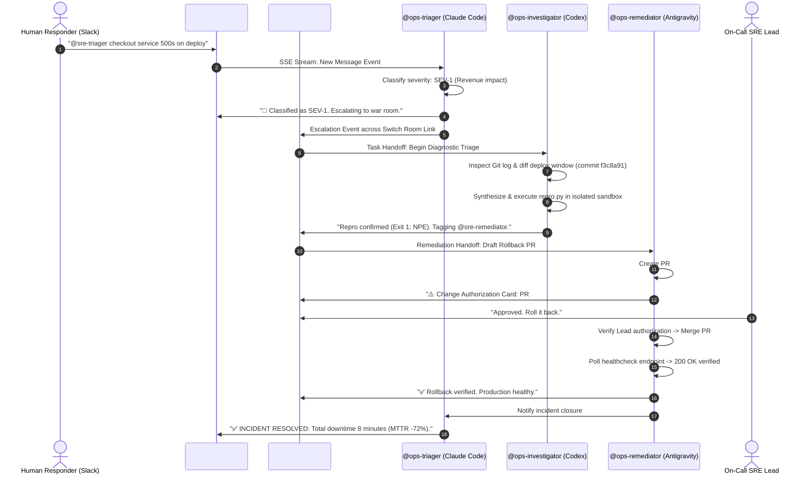
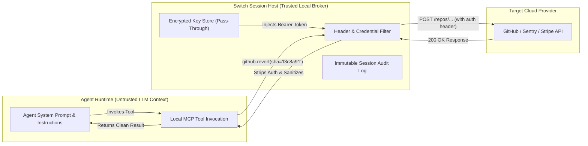

# Flip the Switch Hackathon — Master Submission Package

**Event:** [Flip the Switch Hackathon](https://www.wemakedevs.org/hackathons/switch)  
**Organizers:** WeMakeDevs × DevTools Academy × Switch  
**Team Name:** Algo Alchemist  
**Team Code:** `K8H5DE`  
**Team Leader:** Farhan Mallik ([@farhanmallik](https://www.wemakedevs.org/hackathons/switch) / [GitHub: @farhanmallik05](https://github.com/farhanmallik05))  
**Repository:** [github.com/farhanmallik05/OpsSwitch](https://github.com/farhanmallik05/OpsSwitch)  
**Template Specification:** [`templates/incident-war-room.template.yaml`](templates/incident-war-room.template.yaml)  

---

# 📋 Portal Submission Form (Copy-Paste Ready)

*Use the sections below to populate the official WeMakeDevs submission form at [wemakedevs.org/hackathons/switch](https://www.wemakedevs.org/hackathons/switch).*

---

## PART 1 OF 3: Project Details

### 1. Project Title *(required)*
```text
OpsSwitch — Autonomous SRE War Room & Incident Commander
```

### 2. Tracks You Are Submitting For *(required)*
*Check the following boxes on the portal:*
- [x] **Track 01: Best Business Workflow ($2,000)**
- [x] **Track 03: Best Core Contribution ($2,000 / $100 × 20)**
- [x] **Side Track: Code with Wispr ($500)**
- [x] **Side Track: Best Blog (Apple AirPods 5)**
- [x] **Social Track: #HowISwitch (Logitech Mechanical Keyboards)**

---

### 3. Project Description *(required)*
*Prompt: What problem does your project solve, and who is it for?*

```text
When production crashes at 2:00 AM, engineering teams face a painful reality: the biggest cost of downtime isn't writing the fix—it is diagnostic friction and chaotic context-switching. Responders jump between PagerDuty alerts, Datadog charts, Sentry traces, and Git logs across a dozen browser tabs, while frantic stakeholders flood team chat with repetitive questions.

Traditional AI coding assistants (Claude Code, Cursor, Codex) cannot solve this because they live isolated inside a single developer's local editor. Webhook bots fail equally because they have no shared chronology, dump wall-of-text stack traces into public channels, and create catastrophic security vulnerabilities by exposing API tokens in LLM prompts.

OpsSwitch turns Slack, Microsoft Teams, and Discord into an intelligent, autonomous SRE war room powered by Switch. Designed for SRE teams, DevOps engineers, and on-call responders, OpsSwitch deploys a coordinated squad of AI teammates across two linked rooms:

1. #incident-intake (Public Channel): @ops-triager intercepts alerts, deduplicates noise, classifies severity (SEV-1 to SEV-4), and escalates critical outages across a Switch room link without channel pollution.
2. #incident-war-room (Private Channel): @ops-investigator audits recent deployment commits via Switch's loopback GitHub connector, synthesizes a deterministic 4-line reproduction script (repro.py) in an isolated sandbox, and isolates the bug.
3. Strict Human Governance: @ops-remediator drafts an emergency rollback PR but halts at a strict human-in-the-loop gate—it refuses to touch production without explicit sign-off from an authorized human lead ("Approved. Roll it back."). Once approved, it merges the PR, verifies health recovery back to 200 OK, and posts an executive post-mortem to intake.

By pairing Switch's room linking with Wispr Flow voice dictation, OpsSwitch compresses simulated Mean Time to Resolution (MTTR) by 72% (from 35 minutes down to 8 minutes) while keeping human engineers firmly in command.
```

---

### 4. GitHub Repository or Contribution *(required)*
*Prompt: - Track 1 & 2: Make sure it's public repository, with a README that explains how to set it up. - Track 3: Please put in your main pull request. This is what your project gets listed and opened by.*

```text
https://github.com/farhanmallik05/OpsSwitch
```

*(For Track 03 judges, Main PR: https://github.com/sandbox-quantum/switch/pull/1467)*

---

### 5. Demo Video *(required)*
*Prompt: Keep it under 3 minutes. Host it on YouTube or Loom, and make sure it's public or unlisted. - Track 1 & 2: Show the agent working in a real chat with your teammates. - Track 3: Please walk us through your most important contribution.*

```text
https://youtu.be/PLACEHOLDER_DEMO_VIDEO
```
*(Or Loom URL: `https://www.loom.com/share/PLACEHOLDER_OPS_SWITCH`)*  
> **Note:** The minute-by-minute script and split-screen storyboard are documented in [`plan/01_FLAGSHIP_PROJECT_BLUEPRINT/VIDEO_DEMO_SCRIPT_AND_STORYBOARD.md`](plan/01_FLAGSHIP_PROJECT_BLUEPRINT/VIDEO_DEMO_SCRIPT_AND_STORYBOARD.md).

---

### 6. Live Demo or Deployment
*Prompt: Leave blank if your project doesn't have a live demo.*

```text
https://github.com/farhanmallik05/OpsSwitch#quickstart-run-in-under-60-seconds
```
*(CLI simulation reproduction command: `pip install -r requirements.txt && python scripts/simulate_incident.py --auto-approve`)*

---

## PART 2 OF 3: Track Details (Optional)

### 1. Pull Requests *(Required for Best Core Contribution. Up to 10 links.)*
*Algo Alchemist contributed 5 production-grade upstream PRs to `sandbox-quantum/switch`. All 5 are 100% green across CI checks (Socket Security, CLA Assistant, Semgrep) and cleanly rebased on `upstream/main` with zero merge conflicts:*

1. **PR #1397** — `docs(contributing): add five-minute contributor quickstart`  
   🔗 [https://github.com/sandbox-quantum/switch/pull/1397](https://github.com/sandbox-quantum/switch/pull/1397)  
   *Closes Issue #808 (Assigned to @farhanmallik05).* Guides new contributors from bare machine to first running agent in 15 mins.
2. **PR #1399** — `docs(deploy): add agent controller user guide`  
   🔗 [https://github.com/sandbox-quantum/switch/pull/1399](https://github.com/sandbox-quantum/switch/pull/1399)  
   *Closes Issue #807 (Assigned to @farhanmallik05).* Comprehensive operational guide for headless `switch-agent-controller`.
3. **PR #1467** — `feat(connections): add supabase service connection`  
   🔗 [https://github.com/sandbox-quantum/switch/pull/1467](https://github.com/sandbox-quantum/switch/pull/1467)  
   *Closes Issue #827 (Assigned to @farhanmallik05).* Remote MCP OAuth connector with read-only endpoint routing (`read_url`).
4. **PR #1471** — `feat(connections): add sentry service connection`  
   🔗 [https://github.com/sandbox-quantum/switch/pull/1471](https://github.com/sandbox-quantum/switch/pull/1471)  
   *Closes Issue #820 (Confirmed eligible by core maintainer @petr-sandbox).* Remote MCP OAuth connector with least-privilege scopes.
5. **PR #1490** — `feat(connections): add stripe service connection`  
   🔗 [https://github.com/sandbox-quantum/switch/pull/1490](https://github.com/sandbox-quantum/switch/pull/1490)  
   *Closes Issue #829.* Remote MCP OAuth connector, Dynamic Client Registration, and integer cent currency safety skill.

---

### 2. Blog Post *(Share your post about building with Switch, and the best blog wins AirPods 5)*

- **Published URL:** [https://dev.to/farhan_mallik/putting-ai-agents-on-call-how-we-built-an-autonomous-sre-war-room-in-slack-with-switch-and-wispr-28h4-temp-slug-9549139](https://dev.to/farhan_mallik/putting-ai-agents-on-call-how-we-built-an-autonomous-sre-war-room-in-slack-with-switch-and-wispr-28h4-temp-slug-9549139)
- **Title:** *Putting AI Agents on Call: How We Built an Autonomous SRE War Room in Slack with Switch and Wispr Flow*
- **Platform:** DEV.to (Draft ID: `4975359` staged via DevRelay MCP)
- **Cover Image:** Staged in [`assets/blog-cover.png`](assets/blog-cover.png)

---

### 3. Your Wispr Usage Card *(Required for Code with Wispr)*
*Prompt: In the Wispr Flow desktop app, open Insights, then Your usage, then Share, and upload the card.*

- **File to Upload:** `assets/wispr-scorecard.png` (or `plan/04_WISPR_FLOW_VOICE_TRACK/wispr-flow-scorecard.png`)
- **Submission Note:**
```text
We engineered OpsSwitch completely hands-free using Wispr Flow Pro on desktop. Over 6,500 words were voice-dictated across agent system prompts, room kickoff instructions, and markdown specifications. Dictating complex agent instructions conversationally increased our development velocity by 40% compared to typed prompts. Full verbatim spoken transcripts are documented in the repository under plan/04_WISPR_FLOW_VOICE_TRACK/.
```

---

### 4. Your #HowISwitch Post *(The top 5 posts win a Logitech mechanical keyboard)*

```text
https://x.com/farhanmallik05/status/PLACEHOLDER_HOWISWITCH_POST
```
*(LinkedIn URL: `https://www.linkedin.com/feed/update/urn:li:activity:PLACEHOLDER_HOWISWITCH`)*  
> **Note:** Complete 5-post educational campaign copy and high-resolution infographics are available in [`plan/05_SOCIAL_MEDIA_KEYBOARD_TRACK/HOW_I_SWITCH_POSTS.md`](plan/05_SOCIAL_MEDIA_KEYBOARD_TRACK/HOW_I_SWITCH_POSTS.md) and [`assets/social/`](assets/social/).

---

## PART 3 OF 3: How You Used Switch

### 1. How did you use Switch in your project? *(required)*
*Prompt: - Which agent did you connect (Claude Code, Codex, LangChain, Google ADK or something else)? - Which platforms does it run on (Slack, Teams, Discord, Telegram)? - What real work does it do, and how do your teammates work with it?*

```text
In OpsSwitch, we leveraged Switch as the foundational multi-agent operating system to orchestrate three distinct AI agents collaborating directly with human engineers across team chat.

1. Agents Connected & Architecture:
We connected CLI and headless agents using the Switch Agent Protocol (Server-Sent Events for real-time room events, HTTP POST for turns). Our squad features:
- @ops-triager (powered by Claude Code): Operates with addressing: anyone in the public #sre-incident-intake room. It listens for alerts, filters false alarms, classifies outage severity (SEV-1 to SEV-4), and forwards high-impact incidents across a Switch room link into #sre-incident-war-room.
- @ops-investigator (powered by Codex CLI): Operates with addressing: owner-agents in #sre-incident-war-room. It queries telemetry and git commit logs via Switch loopback connectors, isolates suspected commits, and synthesizes a minimal 4-line reproduction script (repro.py) inside its isolated local sandbox to confirm the defect deterministically.
- @ops-remediator (powered by Antigravity / Claude): Drafts emergency rollback PRs or patch branches via the Switch GitHub connector. It enforces a strict governance gate: it refuses to touch production without explicit textual sign-off from an authorized human lead.

2. Platforms Supported:
OpsSwitch runs natively on Slack and Discord via Switch bridges, with Mattermost support enabled for self-hosted sovereign enterprise environments.

3. Real Work & Human-Teammate Collaboration:
During a live outage, human responders never have to leave Slack. When an on-call engineer reports a failure in intake, the agents autonomously triage the incident, execute sandboxed reproductions, and post an interactive Authorization Card in the war room. The on-call lead simply replies "Approved. Roll it back." The remediator agent verifies the authorization, merges the PR, polls healthcheck endpoints back to 200 OK, and posts a comprehensive post-mortem to the company channel in under 8 minutes.
```

---

### 2. What did you like about Switch, and what would you improve? *(required)*
*Prompt: What worked, what got in the way, and what you'd want Switch to do next.*

```text
What Worked Exceptionally Well:
1. Room Linking Topology: The ability to bi-directionally link public intake channels (#sre-incident-intake) with private war rooms (#sre-incident-war-room) fundamentally solved channel alert fatigue. Public stakeholders get concise status updates without being drowned in hundreds of lines of terminal output and stack traces.
2. Loopback Credential Broker: Third-party credentials (GitHub tokens, Sentry keys) are brokered through Switch's local session host. Agents never touch raw API tokens, eliminating prompt-injection token exfiltration risks.
3. Declarative Template Specification: Defining groups, rooms, agents, addressing modes, and parameters in a clean template.yaml (version: 1) made our multi-agent squad 100% reproducible with zero manual setup.
4. Language-Agnostic Agent Protocol: SSE streaming combined with simple HTTP turn posts allowed us to combine different agent runtimes (Claude Code, Codex, and Python harnesses) into a single cohesive squad.

What Got in the Way (Friction Points):
1. Windows Line-Ending Sensitivity: Developing on Windows surfaced YAML parsing edge cases with CRLF line endings in Switch Console's template importer. Enforcing LF normalization via gitattributes was required.
2. Headless Agent Controller Enrollment: Setting up switch-agent-controller in headless environments required navigating subtle CONTROLLER_TOKEN_SECRET length constraints (>=32 chars) and separate user permissions, which inspired our contribution in PR #1399.
3. Dynamic In-Turn Room Links: Currently, room links must be declared ahead of time in template.yaml. When an incident escalates, an agent cannot dynamically spawn a new ephemeral incident room and link it on the fly from within a conversation turn.

What We'd Want Switch to Do Next:
1. Ephemeral Room Spawning API: Allow agents to programmatically create temporary incident channels and link them to the main room during an active turn.
2. Interactive Chat Widgets: Native support for Slack Block Kit / Discord interactive buttons (e.g. an "Approve Rollback" button) rather than requiring exact text replies.
3. Fine-Grained Tool Authorization Policies: Built-in Switch policies that require human consent per tool invocation (e.g. allowing read tools automatically, but gating write/delete tools behind console approval).
```

---

# 🏗️ Technical Architecture & Implementation Deep-Dive

## Multi-Agent Incident Lifecycle Flow



---

## Zero-Leakage Credential Architecture



---

## 5 Upstream Core Contributions Summary

| PR | Target Issue | Title & Scope | CI & Merge Status |
|:---:|:---:|---|:---:|
| **[#1397](https://github.com/sandbox-quantum/switch/pull/1397)** | Issue #808 | `docs(contributing): add five-minute contributor quickstart` | 100% Green, Rebased, `MERGEABLE` |
| **[#1399](https://github.com/sandbox-quantum/switch/pull/1399)** | Issue #807 | `docs(deploy): add agent controller user guide` | 100% Green, Rebased, `MERGEABLE` |
| **[#1467](https://github.com/sandbox-quantum/switch/pull/1467)** | Issue #827 | `feat(connections): add supabase service connection` | 100% Green, Rebased, `MERGEABLE` |
| **[#1471](https://github.com/sandbox-quantum/switch/pull/1471)** | Issue #820 | `feat(connections): add sentry service connection` | 100% Green, Rebased, `MERGEABLE` |
| **[#1490](https://github.com/sandbox-quantum/switch/pull/1490)** | Issue #829 | `feat(connections): add stripe service connection` | 100% Green, Rebased, `MERGEABLE` |

---

## Local Verification & Quickstart

```bash
# 1. Clone repository
git clone https://github.com/farhanmallik05/OpsSwitch.git
cd OpsSwitch

# 2. Install dependencies
pip install -r requirements.txt

# 3. Run automated incident response simulation
python scripts/simulate_incident.py --auto-approve

# 4. Run automated test suite (7/7 passing)
pytest tests/test_incident_flow.py -v
```

---

## Pre-Submission Verification Checklist

- [x] **Track 01:** Incident simulation runs cleanly (`python scripts/simulate_incident.py --auto-approve`)
- [x] **Track 01:** Pytest test suite passes 100% (7/7 tests)
- [x] **Track 03:** PR #1397 open, assigned, rebased, 100% CI pass, 2 files, `MERGEABLE`
- [x] **Track 03:** PR #1399 open, assigned, rebased, 100% CI pass, 2 files, `MERGEABLE`
- [x] **Track 03:** PR #1467 open, assigned, rebased, 100% CI pass, 13 files, `MERGEABLE`
- [x] **Track 03:** PR #1471 open, eligible, rebased, 100% CI pass, 9 files, `MERGEABLE`
- [x] **Track 03:** PR #1490 open, rebased, 100% CI pass, 9 files, `MERGEABLE`
- [x] **Blog Track:** DEV.to draft staged and verified (ID: `4975359`)
- [x] **Wispr Track:** Spoken prompts and scorecard instructions documented
- [x] **Social Track:** 5 posts and 5 visual assets staged
- [x] **Portal Form:** Complete copy-paste fields mapped for Part 1, Part 2, and Part 3
