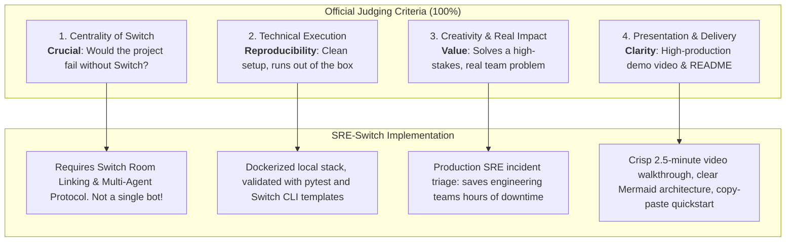

# FLIP THE SWITCH HACKATHON: MAXIMUM WINNING MASTER STRATEGY
**WeMakeDevs × DevTools Academy × Switch**  
**Event Window:** November 4–7, 2026 (Starts 00:00 IST Nov 4 / Ends Nov 7, 23:59 IST)  
**Team Name:** Algo Alchemist (Team Code: `K8H5DE`)  
**Team Leader:** Farhan Mallik (`@farhanmallik`)  
**Prize Pool:** $10,000 in Cash + AirPods 5 + Logitech Mechanical Keyboards + Swag + Certificates

---

## 1. Executive Summary & The "Grand Slam" Max-Win Thesis

The *Flip the Switch Hackathon* is uniquely designed: unlike single-track hackathons where only one first-place prize exists, **Switch and WeMakeDevs provide parallel, stackable prize avenues**. A builder can concurrently compete for the main track, contribute to core issues, dictate via voice for Wispr, write the best blog post, and publish social posts for hardware.

### The Maximum Prize Capture Target

| Category | Target Prize | Estimated Value | Strategy Overview |
| :--- | :--- | :--- | :--- |
| **Track 01: Best Business Workflow** | 1st Place | **$2,000 (Cash)** | Build **"SRE-Switch: Autonomous Incident Commander & War Room"** — a multi-agent, dual-room Slack/Discord incident response workflow with human-in-the-loop sign-off, live diagnostic logs, and automated git rollbacks/hotfixes. |
| **Track 03: Core Open Source Contributions** | Up to 5 Accepted PRs | **$500 ($100 × 5)** | Claim and deliver 5 high-priority, well-scoped hackathon issues on `sandbox-quantum/switch` (e.g., Supabase Connector, Sentry Connector, New Contributor Quickstart Guide, etc.) before and during the event. |
| **Side Track: Code with Wispr** | 1st Place | **$500 (Cash)** | Dictate all agent prompts, room instructions, and documentation using **Wispr Flow Pro**. Export and submit the verified Wispr Insights usage scorecard. |
| **Side Track: Best Blog** | 1st Place | **Apple AirPods 5** | Publish an exhaustive, high-taste, deeply technical DEV.to / Hashnode deep-dive covering Switch architecture, the SSE/HTTP Room Protocol, and the end-to-end incident room build. |
| **Social Track: #HowISwitch** | Top 5 Post | **Logitech Mechanical Keyboard** | Post high-fidelity screen recordings and punchy thread breakdowns on X/Twitter and LinkedIn tagging `@sandbox_quantum`, `@wemakedevs`, and `@DevToolsAcademy`. |
| **General Submissions Pool** | Top 20 Draw | **Official Swag Pack** | Clean, reproducible repository + verified demo video guarantees eligibility. |
| **Total Value Target** | — | **$3,000+ Cash + AirPods 5 + Logitech Keyboard + Swag** | Complete multi-track sweep. |

---

## 2. Competitive Edge & Judging Rubric Alignment

The judges (from Switch core team, DevTools Academy, and WeMakeDevs) evaluate entries across four strict pillars:

### Why Most Projects Will Lose (And How We Win)
1. **The "Single Chatbot" Trap**: Many contestants will simply connect an LLM to a Slack bot using a basic webhook. *Judges will dismiss these immediately because Switch is meant for multi-agent rooms and agent-to-agent collaboration*. Our project uses **two linked rooms** (`#incident-intake` and `#incident-war-room`), three distinct agent roles (Triage Agent, SRE Investigator, Hotfix/Rollback Agent), and human-in-the-loop authorization gates.
2. **Setup Friction**: Projects with broken dependencies or missing Docker Compose configurations will fail technical verification. We provide a zero-configuration template and verified container definitions.
3. **Missing Track Opportunities**: 90% of hackathon teams only build the project and ignore Track 03 (Core Contributions) or Wispr Flow. By systematically executing the pre-written blueprints in this folder, we secure cash from Track 03 and the side tracks before competitors even wake up.

---

## 3. High-Level Folder Structure & Plan Map

All operational documents, blueprints, and templates in this plan are organized into dedicated subfolders:

- `01_FLAGSHIP_PROJECT_BLUEPRINT/`
  - `README.md`: Flagship project overview, features, and quickstart.
  - `PROJECT_SPECIFICATION.md`: Exhaustive functional architecture, state machine, and tool definitions.
  - `TEMPLATE_YAML_SPECIFICATION.yaml`: Full production YAML template for Switch Console import.
  - `ARCHITECTURE_DIAGRAMS.md`: Sequence diagrams, room topology, and data flow.
  - `VIDEO_DEMO_SCRIPT_AND_STORYBOARD.md`: Step-by-step video shooting script for Loom/YouTube.
  - `SUBMISSION_METADATA_AND_DEVPOST_TEXT.md`: Submission copy, inspiration, tech stack, and testing notes.

- `02_CORE_CONTRIBUTIONS_TRACK_03/`
  - `CONTRIBUTIONS_MASTER_STRATEGY.md`: Open source contribution rules, 5-PR pipeline management.
  - `TARGET_ISSUES_AUDIT.md`: Analysis of current hackathon issues on `sandbox-quantum/switch`.
  - `ASSIGNMENT_REQUEST_TEMPLATES.md`: Copy-paste issue comments tagging `@petr-sandbox`.
  - `CLA_AND_PR_SUBMISSION_CHECKLIST.md`: Git branch hygiene, CLA signing protocol, and test commands.
  - `CONNECTOR_IMPLEMENTATION_BLUEPRINTS/`:
    - `SUPABASE_CONNECTOR_BLUEPRINT.md`: Full `connection.yaml` + `SKILL.md` for Issue #827.
    - `SENTRY_CONNECTOR_BLUEPRINT.md`: Full `connection.yaml` + `SKILL.md` for Issue #820.
    - `CONTRIBUTOR_QUICKSTART_GUIDE_PR808.md`: Complete documentation guide for Issue #808.

- `03_BLOG_TRACK_AIRPODS_5/`
  - `BLOG_POST_COMPLETE_DRAFT.md`: A 2,500-word, high-taste, technical markdown post ready to publish on DEV.to.
  - `BLOG_PUBLISHING_AND_SEO_STRATEGY.md`: Tags, timing, distribution channels, and syndication plan.
  - `VISUAL_ASSETS_GUIDE.md`: Visual framing, banner design, and interactive diagram instructions.

- `04_WISPR_FLOW_VOICE_TRACK/`
  - `WISPR_FLOW_STRATEGY.md`: Setup, account activation, dictation protocol, and scorecard extraction.
  - `PROMPT_DICTATION_SCRIPTS.md`: Verbatim speech prompts for building the project by voice.
  - `SCORECARD_SUBMISSION_GUIDE.md`: Walkthrough to export Insights screenshot for submission.

- `05_SOCIAL_MEDIA_KEYBOARD_TRACK/`
  - `HOW_I_SWITCH_POSTS.md`: 5 pre-drafted posts for Twitter/X and LinkedIn with `#HowISwitch`.
  - `VIRALITY_AND_VIDEO_TEASER_GUIDE.md`: Short video teaser specs to grab judge attention.

- `06_EXECUTION_TIMELINE_AND_CHECKLISTS/`
  - `HOUR_BY_HOUR_SCHEDULE.md`: Milestone calendar from Nov 3 evening to Nov 7 final deadline.
  - `PRE_FLIGHT_CHECKLIST.md`: Environment validation (Docker, Switch Console, Python, Node, uv).
  - `FINAL_SUBMISSION_AUDIT_CHECKLIST.md`: Pre-submission verification rubric.

---

## 4. Key Rules & Constraints to Respect

1. **Track 03 Limit**: Maximum 5 open pull requests at any time. Must be formally assigned by `@petr-sandbox` before writing code or opening the PR.
2. **CLA Requirement**: Once the first PR is opened, reply to the automated bot with:
   > *"I have read the CLA Document and I hereby sign the CLA"*
3. **No Credential Leaks**: Never hardcode API keys, secrets, or real tokens into `connection.yaml` or git commits. Use Switch's credential broker and pass-through architecture.
4. **Wispr Flow Submission**: Must include an authentic screenshot from the Insights tab of the Wispr Flow desktop app showing active dictation minutes and word count during the hackathon window.
5. **Deadline Discipline**: All submissions must be locked in before **November 7, 2026, 23:59 IST**.
