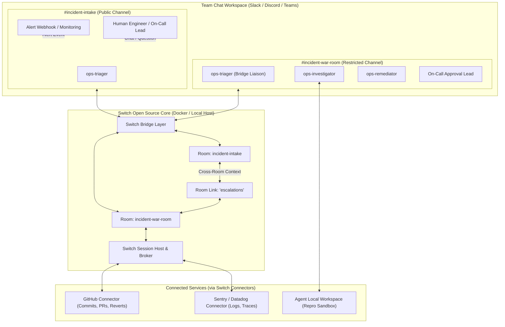
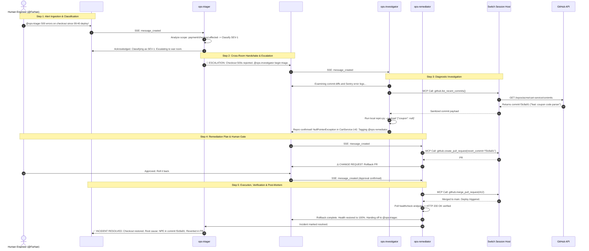
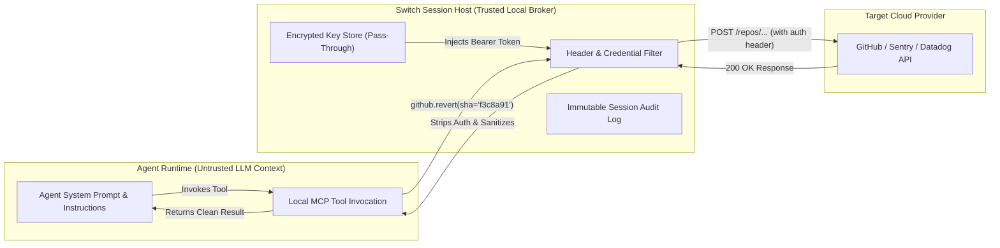

# OpsSwitch: Architectural Diagrams & Topology

This document details the system design, communication protocols, and sequence interactions powering OpsSwitch.

---

## 1. System Topology & Dual-Room Architecture

The multi-room model ensures that sensitive investigation details, high-volume stack traces, and experimental reproduction scripts are contained within the `#incident-war-room`, while clean status updates and resolution notices flow back to `#incident-intake`.

---

## 2. End-to-End Incident Resolution Sequence Diagram

The following sequence illustrates the exact turn-by-turn workflow during a live SEV-1 production failure.

---

## 3. Data Flow & Zero-Leakage Credential Architecture

Security is guaranteed through Switch's isolated broker architecture:

### Key Security Safeguards
1. **Agent Ignorance**: The agent has no access to environment variables containing API tokens.
2. **Strict Loopback**: Tool execution occurs over local Unix sockets or loopback HTTP (`127.0.0.1`).
3. **Audit Trail**: Every tool invocation and human approval is immutably logged in the session transcript.
