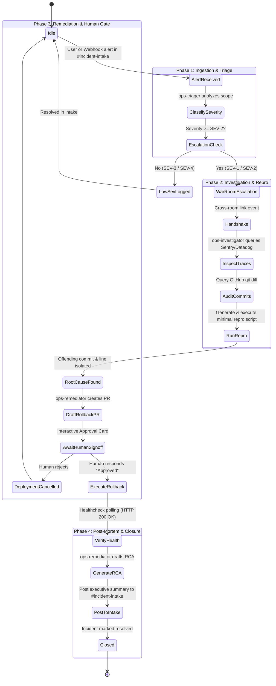

# OpsSwitch: Technical & Architectural Specification

**Document Version:** 1.0.0  
**Target Event:** Flip the Switch Hackathon (Nov 4–7, 2026)  
**Track:** Track 01 — Best Business Workflow ($2,000 Cash)  
**System Name:** OpsSwitch Autonomous Incident Commander  

---

## 1. Problem Statement & Business Justification

Modern software engineering organizations operate complex distributed microservices where unexpected outages, regression bugs, and infrastructure degradations directly impact revenue.
According to Gartner and PagerDuty incident reports:
- The average cost of enterprise downtime exceeds **$5,600 per minute** (~$300k/hour).
- **Mean Time to Acknowledge (MTTA)** and **Mean Time to Diagnose (MTTD)** account for over **70%** of total incident duration.
- Engineers lose critical minutes navigating across disconnected tools: Sentry, Datadog, GitHub commits, Docker logs, Slack channels, and deployment dashboards.
- Critical remediation errors occur when engineers rush manual hotfixes under high pressure without proper reproduction testing or managerial sign-off.

### The Solution: OpsSwitch
OpsSwitch leverages **Switch** to introduce a collaborative squad of autonomous AI teammates directly inside engineering chat (Slack, Discord, Teams, Mattermost). Instead of replacing human engineers, OpsSwitch creates a synchronized, multi-room incident room where AI teammates handle high-speed log ingestion, git commit diffing, automated failure reproduction, and rollback preparation—while enforcing human-in-the-loop executive sign-off before making any production changes.

---

## 2. Multi-Room Topology & Agent Architecture

Switch enables multi-room linking with granular access control. Rather than dumping every verbose log line into a noisy general channel, OpsSwitch structures collaboration into two dedicated rooms:

```
┌────────────────────────────────────────────────────────────────────────┐
│                         SWITCH ROOM TOPOLOGY                           │
│                                                                        │
│   Room A: #incident-intake                   Room B: #incident-war-room │
│   ─────────────────────────                  ───────────────────────── │
│   Audience:                                  Audience:                 │
│   • On-Call Engineers                        • Incident Commander (AI) │
│   • Product Managers                         • SRE Investigator (AI)   │
│   • Customer Support Leads                   • Remediator / Scribe (AI)│
│   • AI Triager Agent                         • Lead On-Call Engineer   │
│                                                                        │
│   Role:                                      Role:                     │
│   • Alert ingestion & dedup                  • Sentry/Datadog deep dive│
│   • Human-readable status                    • Local git repo checkout │
│   • High-level SEV tagging                   • Minimal repro script run│
│   • Final RCA summary post                   • PR creation & sign-off  │
│                                                                        │
│               │                                          ▲             │
│               │       Switch Room Link ("escalations")   │             │
│               └──────────────────────────────────────────┘             │
└────────────────────────────────────────────────────────────────────────┘
```

### Specialized Teammate Roles

#### 1. `{team}-triager` (Intake & Classification Specialist)
- **Room Membership:** `#incident-intake` and `#incident-war-room` (acts as the bridge liaison).
- **Addressing Mode:** `anyone` (listens to all messages, alerts, and mentions in intake).
- **Core Responsibilities:**
  1. Ingest incident alerts from human reports or webhook triggers.
  2. Parse error signatures, customer impact, and affected endpoints.
  3. Classify severity according to standard SRE taxonomy:
     - **SEV-1 (Critical):** Core revenue stream blocked, data loss, catastrophic downtime.
     - **SEV-2 (High):** Significant feature degraded, no immediate workaround.
     - **SEV-3 (Medium):** Minor bug, cosmetic issue, or low-traffic endpoint failure.
     - **SEV-4 (Low):** Informational or inquiry.
  4. Deduplicate multiple incoming reports into a single canonical incident record.
  5. Cross-post a succinct one-line incident brief into `#incident-war-room` tagged to `@ops-investigator`.

#### 2. `{team}-investigator` (SRE Diagnostic & Root-Cause Specialist)
- **Room Membership:** `#incident-war-room` only.
- **Addressing Mode:** `owner-agents` (responds to mentions from triager or human lead).
- **Core Responsibilities:**
  1. Receive incident context from the triager.
  2. Query Sentry/Datadog MCP connectors to extract recent stack traces, frequency counts, and error timestamps.
  3. Query the GitHub connector to pull commit history across the deployment window (e.g., changes within the last 2 hours).
  4. Perform semantic git diff analysis: identify code changes matching the stack trace frames.
  5. Generate a minimal, deterministic reproduction script (`repro.sh` or `repro.py`) inside its local sandbox and execute it.
  6. Present the diagnostic summary to the room: offending commit hash, author, file, line number, and exact repro output.

#### 3. `{team}-remediator` (Mitigation & Governance Specialist)
- **Room Membership:** `#incident-war-room` only.
- **Addressing Mode:** `owner-agents` (collaborates directly with investigator and human lead).
- **Core Responsibilities:**
  1. Formulate the safest remediation strategy:
     - **Strategy A (Fast Rollback):** Revert the offending commit or trigger a rollback deployment to the prior stable release tag.
     - **Strategy B (Targeted Hotfix):** Draft a patch branch resolving the isolated null-check/type error if rollback is destructive.
  2. Use the GitHub connector to generate the rollback PR or patch branch.
  3. Formulate an **Authorization Card** in chat:
     - Summary of changes.
     - Risk assessment (blast radius, database migration safety).
     - Explicit request for human sign-off (`"Awaiting sign-off from On-Call Lead @Farhan"`).
  4. **Strict Safety Protocol:** Never merge or trigger deployments without human confirmation text (`"Approved"`).
  5. Upon approval: execute PR merge, verify CI build triggers, monitor health check endpoints until 200 OK is verified, and hand off post-mortem data to the triager.

---

## 3. Switch Agent Protocol Integration

Switch uses a standardized, language-agnostic Agent Protocol:
- **Server-Sent Events (SSE) In:** Agents connect to `http://localhost:8000/v1/agents/{agent_id}/events` to stream room messages, user mentions, link updates, and tool grants in real-time.
- **HTTP Out:** Agents post structured thoughts, status reactions, markdown text, and tool calls back to `http://localhost:8000/v1/rooms/{room_id}/messages`.

```
 Agent Process (Claude Code / Codex / LangChain)
       │
       ├──[ 1. GET /v1/agents/{agent_id}/events (SSE Stream) ]──► Switch Core
       │   ◄── Event: message_created (User: "@sre-triager 500s on /checkout")
       │
       ├──[ 2. POST /v1/rooms/{room_id}/messages ]──────────────► Switch Core
       │   Body: {"content": "Investigating alert...", "thread_id": "..."}
       │
       └──[ 3. MCP Tool Call via Loopback ]─────────────────────► Switch Session Host
           Call: github.list_commits(repo="acme/api", since="2026-11-03T09:00:00Z")
           ◄── Returns sanitized commit list (No raw credentials in agent env)
```

### Why This Protocol Architecture Wins:
1. **Model & Harness Agnostic:** The triager can run lightweight Gemini Flash via Python, the investigator can run Claude Code on a workstation with local compiler access, and the remediator can run on GitHub Copilot CLI or Codex.
2. **Deterministic Context Isolation:** Agents only receive SSE events for the specific rooms they have been granted access to.

---

## 4. End-to-End Incident Lifecycle (State Machine)



---

## 5. Security Architecture & Blast Radius Mitigation

Security is a primary judging and evaluation criterion. OpsSwitch enforces zero-trust principles:

1. **Credential Pass-Through via Session Host:**
   - LLMs are prone to prompt injection and accidental leakage in chat.
   - Switch's architecture ensures GitHub Personal Access Tokens and Sentry API keys **never touch the agent environment or LLM prompts**.
   - Instead, the agent invokes standard MCP tools (`github.revert_commit`, `sentry.get_issue`). Switch's session host proxies the call, applies OAuth/API-key headers, and strips sensitive authorization headers before returning the JSON output.

2. **Mandatory Human-in-the-Loop Sign-Off:**
   - Automated git pushes to protected branches (`main`, `production`) or production container rollbacks are strictly gated.
   - The remediator agent is programmatically constrained by its instructions: it can create branches and PRs, but cannot merge or execute rollbacks without the verbatim approval token from an authenticated human user listed in the room's `users` parameter.

3. **Read-Before-Write Principle:**
   - The investigator agent has strictly read-only grants to telemetry and repositories.
   - The remediator agent has write access scoped exclusively to the incident working directory and pull requests.

---

## 6. Verification and Reproducibility Plan

Judges must be able to clone the repository and reproduce the workflow within minutes:
1. **Mock Incident Injector Script (`scripts/simulate_incident.py`):**
   - Provides a standalone Python script that spins up a local mock web server, introduces a deliberate 500 error on `/checkout`, and sends a simulated alert webhook into Switch.
2. **Automated Integration Tests (`tests/test_incident_flow.py`):**
   - Uses `pytest` with `pytest-asyncio` to simulate the full SSE event lifecycle: alert -> triage -> escalation -> repro -> signoff -> resolution.
3. **Switch Template Integrity Check:**
   - Validates that `TEMPLATE_YAML_SPECIFICATION.yaml` conforms to Switch schema v1 syntax.
