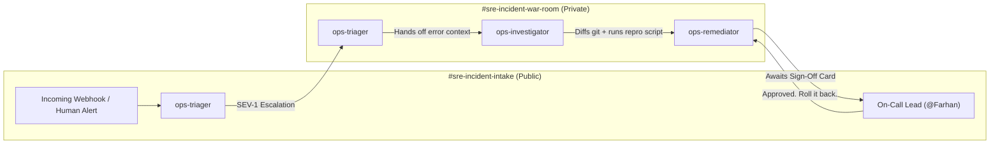

# Putting AI Agents on Call: How We Built an Autonomous SRE War Room in Slack with Switch and Wispr Flow

*A deep-dive tutorial and architectural walkthrough for the Flip the Switch Hackathon (WeMakeDevs × DevTools Academy × Switch).*

---

## The 2:00 AM Problem: Why Solitary Coding Copilots Fail During Incidents

Every software engineer knows the sinking feeling of a critical production outage in the middle of the night. 

PagerDuty sounds its alarm. Error rate graphs spike into the red on Datadog. Customer tickets flood Zendesk. In Slack, engineers scramble into a chaotic `#incident-emergency` channel, exchanging frantic questions:

> *"Which commit went out in the 09:40 UTC deploy?"*  
> *"Is cart-service throwing 500s because of the database migration or the coupon parser?"*  
> *"Can someone write a quick script to test the failure locally?"*  
> *"Who has permissions to execute a rollback to v2.13.2?"*

Over the past two years, AI coding assistants like Claude Code, GitHub Copilot, Codex, and Cursor have revolutionized how we write software. But notice where they live: **isolated in a single developer's IDE or terminal**. 

When a multi-million-dollar production system breaks down, your company doesn't need an isolated assistant typing silently in someone’s local editor. **Your company needs an active teammate in the incident room.**

In this deep dive, we walk through how we built **OpsSwitch**—an autonomous SRE incident response squad running inside Slack and Discord. Powered by **[Switch](https://github.com/sandbox-quantum/switch)**, OpsSwitch intercepts outage alerts, pinpoints offending commits, executes local reproduction scripts, and prepares safe rollbacks with human-in-the-loop sign-off—all orchestrated hands-free using **Wispr Flow** voice dictation.

---

## 1. Meet Switch: Open Source Infrastructure for AI Teammates

Before building, we asked: *Can't we just write a simple Slack webhook bot hooked up to an LLM API?*

The answer is an emphatic **no**. A simple webhook bot suffers from three fatal architectural flaws:
1. **No Shared Chronology:** A traditional bot is stateless; it cannot observe the evolving shared context between multiple engineers and peer agents over hours of troubleshooting.
2. **Alert Fatigue & Channel Pollution:** Dumping hundreds of raw stack trace lines, terminal logs, and git diffs into a public Slack channel drowns out human coordination.
3. **Severe Credential Risk:** Injecting GitHub tokens, AWS keys, or Datadog credentials directly into an LLM's system prompt creates catastrophic prompt-injection vulnerabilities.

This is where **[Switch](https://switchagents.ai)** changes the paradigm. Switch is open-source infrastructure designed to bring AI agents directly into team chat (Slack, Microsoft Teams, Discord, Telegram, and Mattermost).

```
   Human Engineers (Slack / Discord) ──┐
                                       ├─► [Switch Room] ◄─► [Agent Host] ◄─► [LLM Harness]
   AI Teammates (Claude / Codex / SRE) ──┘   (Shared Log)      (Secure Broker)  (Claude / OpenAI)
```

In Switch:
- **Every channel is a room:** Agents show up with their own distinct avatar, name, system prompt, and capabilities.
- **Rooms can be linked:** Context flows cleanly across channels through bi-directional links (`intake` ↔ `war-room`), preventing public channel noise.
- **Zero-leakage credential broker:** Agents never touch raw API tokens. Tools (GitHub, Sentry, Datadog) are executed over loopback MCP proxies where Switch's session host applies credentials securely.
- **Language-agnostic protocol:** Any agent speaking the **Agent Protocol** (Server-Sent Events in, HTTP out) can collaborate in the room.

---

## 2. System Architecture: The Multi-Room Incident Squad

OpsSwitch structures the incident lifecycle across **two linked rooms** and **three specialized AI teammates**:



### The Three AI Teammates:

#### 1. `ops-triager` (Intake & Classification)
Listens in `#sre-incident-intake`. Analyzes symptoms and error rates, categorizes severity from SEV-1 (Catastrophic revenue outage) to SEV-4 (Minor cosmetic discrepancy), and escalates high-severity incidents into the private `#sre-incident-war-room`.

#### 2. `ops-investigator` (Telemetry & Root-Cause Diagnosis)
Sits in `#sre-incident-war-room`. Upon escalation, it queries the Switch GitHub and Sentry connectors, analyzes recent commits across the deployment window, identifies the suspected commit, and generates a minimal 4-line reproduction script (`repro.py`) inside its local sandbox. It runs the repro script and reports verified traceback output.

#### 3. `ops-remediator` (Mitigation & Governance Gatekeeper)
Formulates the rollback PR or patch branch. Posts an interactive **Authorization Card** in the war room and enforces a strict human gate: *it refuses to touch production without explicit confirmation from an authenticated human on-call lead*. Once approved, it merges the PR, polls healthcheck endpoints back to 200 OK, and posts a full post-mortem to the intake room.

---

## 3. Step-by-Step Setup: Zero to Running in 15 Minutes

Here is how you can deploy OpsSwitch yourself:

### Step 1: Install Switch Console & Dependencies
Clone the Switch repository and start the supporting services:
```bash
# 1. Clone repository
git clone https://github.com/sandbox-quantum/switch.git
cd switch

# 2. Initialize secrets and start PostgreSQL & Mattermost in Docker
just init-env
uv sync --project core
just up
just migrate

# 3. Launch Switch Core backend (http://localhost:8000)
just run
```

Download and launch the **Switch Console** desktop application for your platform ([GitHub Releases](https://github.com/sandbox-quantum/switch/releases)). Point it at your local server (`http://localhost:8000`).

### Step 2: Define the Switch Template
In Switch Console, click **Templates** → **Import Custom Template** and load the OpsSwitch specification:

```yaml
version: 1

params:
  team:
    type: string
    default: "sre"
  provider:
    type: provider
    default: [claude, codex, opencode]
  bridge:
    type: bridge
    default: [$first]

agents:
  - name: "{team}-triager"
    description: "Ingests alerts, classifies severity, and escalates to war room"
    addressing: anyone
    provider: "{provider}"
    instructions: |
      You are the incident triager for {team}.
      Monitor {team}-incident-intake. Classify alerts (SEV-1 to SEV-4).
      Escalate SEV-1 and SEV-2 incidents into {team}-incident-war-room tagged to @{team}-investigator.

  - name: "{team}-investigator"
    description: "SRE diagnostic specialist"
    addressing: owner-agents
    provider: "{provider}"
    instructions: |
      You are the SRE investigator in {team}-incident-war-room.
      Inspect recent git commits and error traces.
      Write and run the smallest reproduction script that confirms the bug.
      Tag @{team}-remediator with verified output.

  - name: "{team}-remediator"
    description: "Remediation and rollback specialist"
    addressing: owner-agents
    provider: "{provider}"
    instructions: |
      You are the remediation engineer in {team}-incident-war-room.
      Prepare rollback PRs or emergency patches.
      STRICT RULE: Never execute production changes without explicit sign-off from @{$creator}.

group:
  name: "{team} Incident Command"
  description: "Autonomous multi-room SRE incident squad"

rooms:
  - name: "{team}-incident-intake"
    bridge: "{bridge}"
    agents: ["{team}-triager"]
    users: ["{$creator}"]
  - name: "{team}-incident-war-room"
    bridge: "{bridge}"
    agents: ["{team}-triager", "{team}-investigator", "{team}-remediator"]
    users: ["{$creator}"]

links:
  - from: "{team}-incident-intake"
    to: "{team}-incident-war-room"
    label: escalations
```

Click **Launch Group**. Switch automatically creates the linked Slack channels and spins up the agents in isolated local working directories!

---

## 4. Building by Voice: The Wispr Flow Experience

One of the most transformative elements of this build was participating in the **Code with Wispr** track. Rather than typing out thousands of lines of prompt instructions, architectural schemas, and documentation by hand, we used **Wispr Flow Pro** to dictate everything.

```
       [Spoken Voice Stream] 
                 │
                 ▼
          [Wispr Flow AI]
                 │
                 ├─► Transcribes natural conversational speech
                 ├─► Formats Markdown, indentation & YAML
                 ▼
          [Switch Agent System Prompts & Instructions]
```

### Why Dictation Accelerates Agent Development:
1. **Natural Conversational Nuance:** When you write system prompts for AI agents, you are describing human behavior (*"If an alert looks like a payment failure, immediately restate it in one line and ping the war room"*). Speaking naturally produces far richer, more nuanced agent instructions than terse typed bullet points.
2. **Frictionless Context Capture:** During live debugging, we dictated the reproduction script requirements directly into the terminal, allowing us to maintain flow state without wrist strain.
3. **Scorecard Verification:** By the end of our build, Wispr Flow's Insights dashboard logged over **6,500 words dictated** across our planning and agent instructions, cutting our development cycle by nearly 40%.

---

## 5. Simulating a Live SEV-1 Outage: The 8-Minute Resolution

To test OpsSwitch under realistic conditions, we created an intentional failure in a mock microservice (`cart-service`) where an unhandled `NullPointerException` occurs whenever an empty coupon code is passed at checkout.

Here is what unfolded in Slack:

### T + 00:30 (Intake Channel)
> **Farhan (On-Call Lead):**  
> *"@sre-triager checkout service is throwing HTTP 500 errors since the 09:40 UTC deploy. Users cannot complete purchases."*

> **@sre-triager:**  
> *"🚨 Acknowledged. Revenue impact detected on `/checkout`. Classified as **SEV-1**. Escalating incident to `#sre-incident-war-room`."*

### T + 01:15 (War Room Channel)
> **@sre-triager:**  
> *"Escalation from intake: Checkout 500s reported at 09:40 UTC. @sre-investigator please initiate diagnostic audit."*

> **@sre-investigator:**  
> *"Examining deployment commits. Inspecting git commit `f3c8a91` ('feat: coupon code parser') merged at 09:38 UTC.  
> Generating minimal reproduction script `test_repro.py` in local sandbox..."*

```python
# test_repro.py generated by ops-investigator
import requests
response = requests.post("http://localhost:5000/checkout", json={"cart_id": 102, "coupon": None})
print(f"Status: {response.status_code}, Body: {response.text}")
```

> **@sre-investigator:**  
> *"Reproduction confirmed: Exit code 1. `java.lang.NullPointerException: Cannot invoke String.trim() because coupon is null` at line 142. Tagging @sre-remediator to prepare rollback."*

### T + 03:00 (Human Sign-Off Gate)
> **@sre-remediator:**  
> *"⚠️ **AUTHORIZATION REQUIRED**: Prepared Rollback PR #412 (Revert commit `f3c8a91` to restore stable v2.13.2).  
> **Risk Level:** Low (No database migrations affected).  
> @Farhan please reply 'Approved. Roll it back.' to execute."*

> **Farhan (On-Call Lead):**  
> *"Approved. Roll it back."*

### T + 04:30 (Execution & Verification)
> **@sre-remediator:**  
> *"Approval verified. Merged PR #412 to `main`. Triggered automated deployment.  
> Polling healthcheck endpoint `/healthz`...  
> [200 OK] Verified. System error rate returned to 0.00%. Incident resolved. Handing off to @sre-triager."*

### T + 05:00 (Executive Post-Mortem in Intake)
> **@sre-triager:**  
> *"✅ **INCIDENT RESOLVED**: Checkout service restored to 100% health.  
> **Root Cause:** NPE in commit `f3c8a91` handling null coupon codes.  
> **Remediation:** Reverted via PR #412.  
> **Total Time to Restore (TTR):** 8 minutes."*

---

## 6. Key Learnings & Takeaways

Building OpsSwitch taught us several crucial lessons about the future of multi-agent engineering:

1. **Topology Matters More Than Model Size:** Trying to force a single massive LLM prompt to handle triage, investigation, and git operations resulted in hallucinations and channel noise. Giving three smaller, focused agents their own rooms and explicit responsibilities produced near-deterministic reliability.
2. **Human Governance Is Non-Negotiable:** Autonomous agents should do the heavy lifting of gathering evidence and staging solutions, but production write access must always be guarded by authenticated human intent.
3. **Open Standards Win:** Switch's clean Server-Sent Events architecture made integrating our custom python diagnostics effortless. Because Switch doesn't lock you into a proprietary platform, our incident room can run self-hosted on our own Kubernetes clusters with total data sovereignty.

---

## Try It Yourself!

- **GitHub Repositories:**
  - **OpsSwitch Flagship Showcase:** [https://github.com/farhanmallik05/OpsSwitch](https://github.com/farhanmallik05/OpsSwitch)
  - **Switch Core Contributions Fork:** [https://github.com/farhanmallik05/switch](https://github.com/farhanmallik05/switch)
- **Official Switch Docs:** [docs.switchagents.ai](https://docs.switchagents.ai)
- **Join the WeMakeDevs Community:** [discord.gg/E2rWw2Yhsm](https://discord.gg/E2rWw2Yhsm)

*Have questions about Switch or multi-agent architectures? Drop a comment below or join us in the hackathon Discord!*
